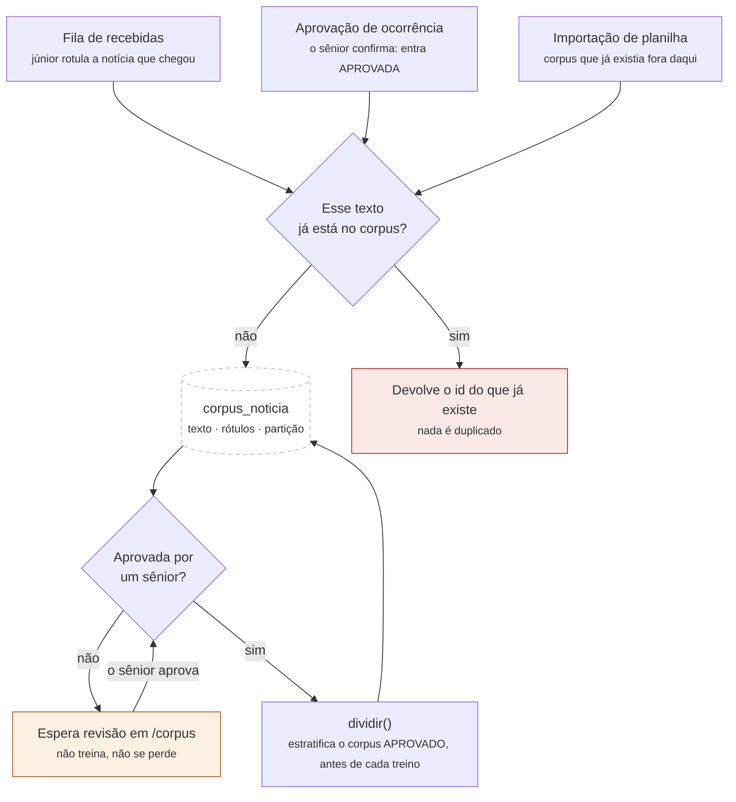
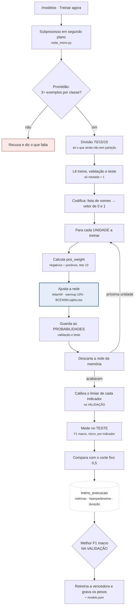
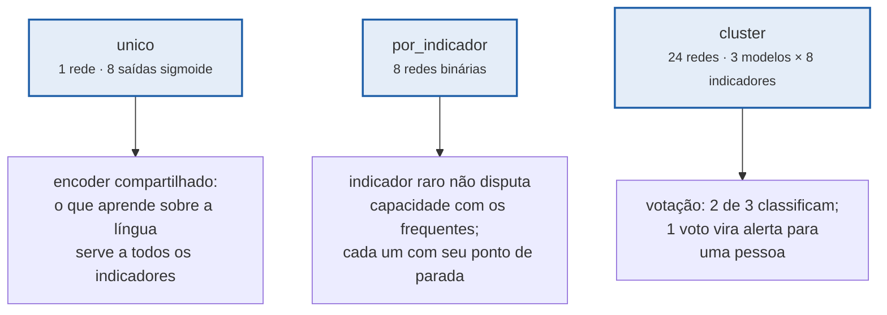
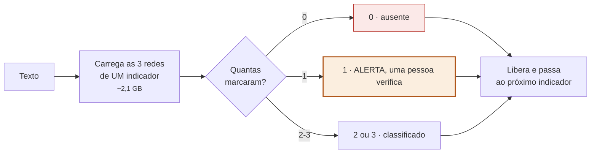
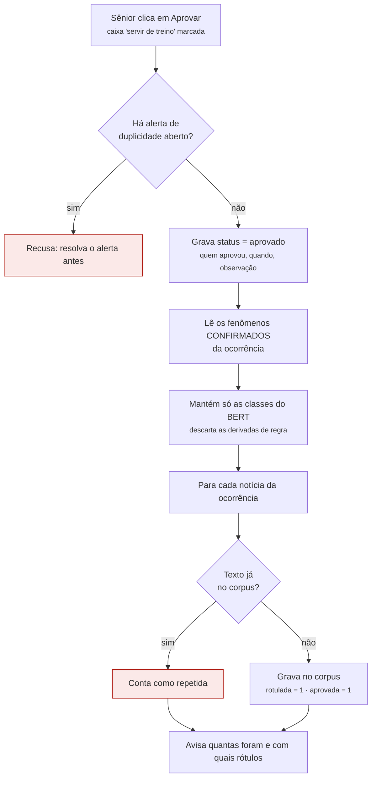
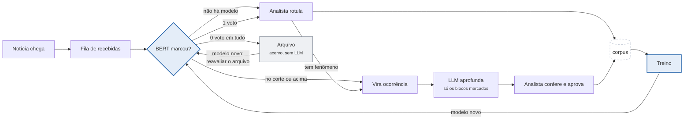

# Fluxograma do treinamento

Companheiro de [fluxograma.md](fluxograma.md), que descreve o caminho de uma
notícia até virar registro. Aqui é o outro ciclo: como o classificador aprende.

Fonte em Mermaid; renderiza no GitHub e na pré-visualização do VS Code. Para
exportar imagem, <https://mermaid.live>.

Mantenha junto do código: um fluxograma que descreve uma versão antiga do fluxo
é pior que nenhum.

---

## 1. De onde vem o rótulo

Antes de treinar é preciso ter exemplo rotulado, e há **três portas** por onde
ele entra. Nenhuma delas pede trabalho extra: todas aproveitam decisão que
alguém já tomou por outro motivo.

**Por que a verificação de repetição.** A mesma notícia chega por mais de uma
porta — o analista rotula na fila e depois aprova a ocorrência feita dela. Sem
a comparação por `impressao` (sha1 do texto normalizado), o mesmo exemplo
entraria duas vezes e poderia cair **em treino e em teste ao mesmo tempo**.
Isso é vazamento: a métrica sobe sem o modelo melhorar.

**Por que a partição é atribuída em LOTE, e não na inserção.** A notícia nasce
com `particao` em branco e quem a preenche é `dividir()`, que o treino chama
sozinho quando encontra exemplo pendente — ninguém precisa clicar em
"sortear".

Sortear na hora de inserir foi tentado e é **pior**, por um motivo que só
aparece medindo: a estratificação olha quanto falta de cada indicador para
equilibrar as três partições, e uma notícia por vez não tem esse panorama. Na
medição, três classes ficaram sem nenhum exemplo na validação e o teste ficou
sem nenhum exemplo negativo. Em lote, o algoritmo começa sempre pelo indicador
com menos exemplos ainda por distribuir, e é isso que garante exemplo de cada
um nas três partições.

A divisão feita fica **gravada no banco**: refazer o sorteio a cada treino
mudaria o conjunto de teste e tornaria dois modelos incomparáveis.

**Rótulo vazio é rótulo.** A notícia lida e sem nenhum indicador é o exemplo
negativo, e sem ele o modelo nunca aprende a recusar o que está fora do escopo.
A coluna `rotulada` existe só para distinguir "li e não há nada" de "ninguém
olhou ainda".

**Rotulado não é aprovado, e só o aprovado treina.** `aprovada` é a segunda
coluna, e a razão dela é a divisão de trabalho real: quem cadastra a ocorrência
é o analista júnior, quem revisa é o sênior. Um rótulo errado do júnior não
produz um erro visível — produz um modelo pior, errando em notícia que ninguém
está olhando. É o defeito que não aparece em tela nenhuma, e por isso a trava
fica na consulta de treino (`corpus.TREINAVEL`), escrita uma vez só: espalhar
`rotulada = 1` por sete consultas é o que permitia esquecer uma.

Mudar o rótulo derruba a aprovação e libera a vaga de partição — rótulo novo é
afirmação nova, e um exemplo que saiu do treino não guarda lugar reservado.

**E o treino só roda com 30 positivos aprovados de CADA classe**
(`corpus.MINIMO_POR_CLASSE`), na tela e na linha de comando. Antes isso era um
aviso, e o que ele deixava passar era pior que o incômodo da trava: uma classe
com 2 exemplos — ou com zero, num indicador recém-criado — treinava para dizer
sempre não e saía com F1 0, que parece defeito do modelo e é falta de dado. A
saída, quando uma classe rara segura o resto, é `rodar_treino.py --classe`, que
aplica a mesma trava só ao subconjunto pedido.

---

## 2. O treinamento, passo a passo

### Por que cada passo está ali

**Subprocesso em segundo plano.** O treino leva minutos e carrega um BERT
inteiro. Dentro da requisição, ele penduraria o navegador e derrubaria o
servidor junto se estourasse a memória. Em processo separado, a aplicação segue
respondendo e um treino que falha morre sozinho.

**Prontidão antes de tudo.** São precisos ao menos 3 exemplos da classe mais
rara — um para cada partição. Abaixo de 30, a métrica daquela classe é ruído:
com 4 exemplos no teste, acertar 3 ou 4 move o recall de 0,75 para 1,00. O
número não trava nada, só avisa.

**Divisão 70/15/15, e só do que falta.** Resortear tudo a cada treino mudaria o
conjunto de teste, e dois modelos medidos em testes diferentes não são
comparáveis — um modelo avaliado na semana passada teria sido medido num teste
que já não existe. A estratificação é por classe e uma notícia por vez,
começando pela **mais rara**: é o que garante exemplo dela nas três partições.
Sem exemplo na validação não há limiar para calibrar; sem exemplo no teste não
há métrica para reportar.

**Codificação em vetor.** Lista de nomes vira vetor de 0 e 1, uma posição por
indicador. É multirrótulo, não multiclasse: a pergunta não é "qual é o
indicador desta notícia" e sim "quais destes oito ela sustenta". Vetor todo
zero é o exemplo negativo, e é válido.

**`pos_weight` na perda.** Com 20 exemplos de um indicador contra 400 sem ele,
a perda não ponderada é quase minimizada por um modelo que **nunca o marca** —
e o sintoma disso é o clássico "só sai um indicador". O peso é a razão entre
negativos e positivos, com teto de 10 para que uma classe com 2 exemplos não
domine o gradiente.

**A rede devolve probabilidade, não decisão.** O corte vem depois, da
calibração. É isso que permite medir o mesmo modelo com cortes diferentes sem
retreinar.

**Descartar a rede antes da próxima.** É o que torna possível treinar as 24
redes do cluster numa placa de 8 GB: só uma vive por vez.

**Calibrar na VALIDAÇÃO, medir no TESTE.** Cortar todo mundo em 0,5 é palpite:
a saída de um indicador raro costuma ficar abaixo disso mesmo quando é o rótulo
certo, e aí ele nunca aparece. Cada indicador recebe o limiar que maximiza o F1
*dele* na validação. Calibrar no teste inflaria o número que vai para a banca.
Empate fica com o limiar mais baixo de propósito: aqui um falso positivo é
descartável — a LLM recebe o bloco daquela classe e pode descartá-la — enquanto
um falso negativo é perda definitiva, porque a classe que o BERT não marcou nem
chega a ser avaliada.

**A comparação com 0,5.** As métricas trazem também o F1 que o *mesmo* modelo
teria com todos os cortes em 0,5. A diferença entre os dois é o efeito medido
da calibração — não uma afirmação de que ela ajuda.

**Seleção pela validação.** O melhor é escolhido pelo F1 macro na validação,
não no teste. Escolher pelo teste seria usá-lo duas vezes e o número deixaria
de ser estimativa limpa.

**Retreinar a vencedora para gravar.** As execuções da grade rodam sem salvar
pesos; só a vencedora é refeita com `salvar_modelo=True`. É o preço de não
guardar um checkpoint de cada execução — com 4 configurações × 3 modelos, seria
muito disco para jogar fora.

---

## 3. As três estratégias

O que muda entre elas é só o que conta como **unidade** no laço acima.

Qual é melhor é **resultado medido**, não palpite: `--estrategia todas` treina
as três na mesma partição de teste, e é isso que responde a pergunta.

### O voto do cluster

**Por que um grupo de três por vez.** As 24 redes somam ~17 GB em disco e não
cabem juntas nos 8 GB da placa. Um grupo de três ocupa ~2,1 GB. O ciclo é por
indicador porque o **voto** é por indicador: as três de um precisam estar vivas
ao mesmo tempo para votar, as dos outros não. São oito ciclos de carga por
notícia — mais lento, e é esse o preço de caber.

**Por que cada rede tem o seu próprio limiar.** Se as três compartilhassem o
corte, discordariam menos por construção — e a discordância é justamente o
sinal que manda o caso para uma pessoa.

**Por que 2 de 3, e não unanimidade.** O corte sai de
`FRACAO_PARA_PROSSEGUIR = 2/3`, e é fração de propósito: cravado o número 3,
as estratégias de UMA rede — `unico` e `por_indicador` — nunca passariam, e a
LLM jamais seria chamada nelas. Em 1 de 1 a fração dá 1 voto, que é o
comportamento certo.

Unanimidade ficou de fora porque ela custa recall, e aqui o falso positivo é
descartável: a LLM recebe o bloco daquela classe e pode descartá-la. O falso
negativo, não — a notícia vai para o arquivo e ninguém mais a vê.

As métricas do cluster deixam a escolha auditável, com os três cortes medidos
no MESMO teste: `com_um_voto` (1 voto), o número principal (2 de 3) e
`com_unanimidade` (3 de 3). `revisao_humana` é a fração de decisões que ficou
com 1 voto e precisa de pessoa. Sem esses números, o corte seria palpite.

---

## 4. O ciclo da aprovação

Existe, e é a segunda porta do diagrama 1. Passo a passo:

### Por que cada passo está ali

**Tudo na mesma transação.** A gravação do status e o envio ao corpus são uma
operação só. Não pode existir registro aprovado sem o exemplo de treino
correspondente — se o segundo falhar, o primeiro também desfaz.

**Só as classes do BERT viram rótulo.** Hoje a única de fora é `chacina`, que
existe apenas como regra sobre a lista de vítimas. Ensiná-la ao classificador
seria pedir que ele adivinhasse do texto algo que a contagem já sabe de forma
exata, e criar uma segunda resposta capaz de contradizer a primeira.

`vitimizacao_policial` já esteve nesse grupo e **saiu dele** em 09/10: ela tem
classe de BERT e regra. O motivo é o portão da LLM — a regra roda DEPOIS da
LLM, e o portão acontece ANTES, então policial baleado de folga não disparava
classe nenhuma e ia para o arquivo em silêncio.

**Uma linha de corpus por notícia, não por ocorrência.** Em produção o BERT lê
**uma notícia de cada vez**; treiná-lo com várias notícias concatenadas
ensinaria um formato que ele nunca vai encontrar.

**Limite conhecido e assumido.** O rótulo é da *ocorrência*, e cada notícia
recebe o conjunto inteiro. Numa ocorrência com várias fontes, uma notícia curta
pode receber uma classe que ela sozinha não sustenta — uma que não menciona a
polícia receberia `acao_policial` assim mesmo. Por isso elas entram editáveis
em `/corpus`, e não como verdade intocável.

**Reaprovar não duplica.** A verificação por impressão faz a segunda aprovação
não acrescentar nada, e a mensagem diz quantas já estavam lá.

**Esta é a única porta que já entra aprovada**, e é para isso que ela existe:
quem aprova a ocorrência é o sênior que revisou o trabalho do júnior, então a
decisão dele é a assinatura que o treino exige. Desmarcar a caixa *servir de
exemplo de treino* grava a notícia sem a assinatura, em vez de não gravar —
serve ao registro que está certo mas é exemplo ruim: texto truncado, duas
ocorrências misturadas, fonte duvidosa.

---

## 5. O ciclo inteiro, de volta ao começo

As duas setas que chegam no corpus são as duas portas: a rotulagem na fila
(inclusive a que conclui "não há fenômeno") e a aprovação da ocorrência. As
duas alimentam o mesmo treino, e o modelo que sai dele volta para o começo.

**O que esse ciclo compra além do treino.** Enquanto o BERT não marca nada, a
chamada à LLM leva o catálogo inteiro de indicadores: ~6.750 tokens de prompt,
contra um teto de 8.000 por minuto — e o texto da notícia ainda entra em cima
disso. Com o BERT marcando duas classes, o prompt cai para ~4.620, e com
nenhuma, para ~3.540. É essa folga que permite subir o `reasoning_effort` da
LLM, que é o que estabiliza a extração da lista de vítimas: medido em três
leituras do mesmo texto, `low` devolveu 2, 0 e 1 vítima, e `medium` devolveu 2,
2 e 2. O corpus não serve só ao BERT — ele é o que torna a chamada da LLM
melhor.
