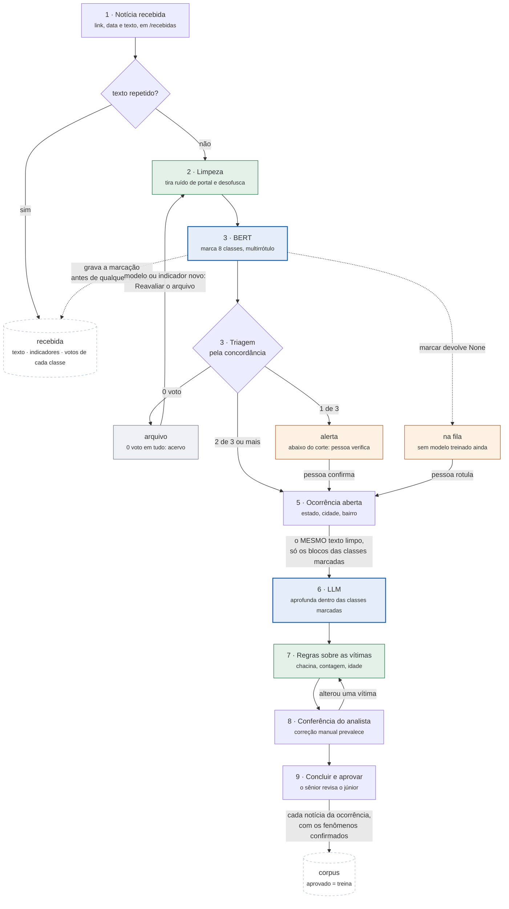
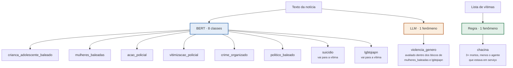
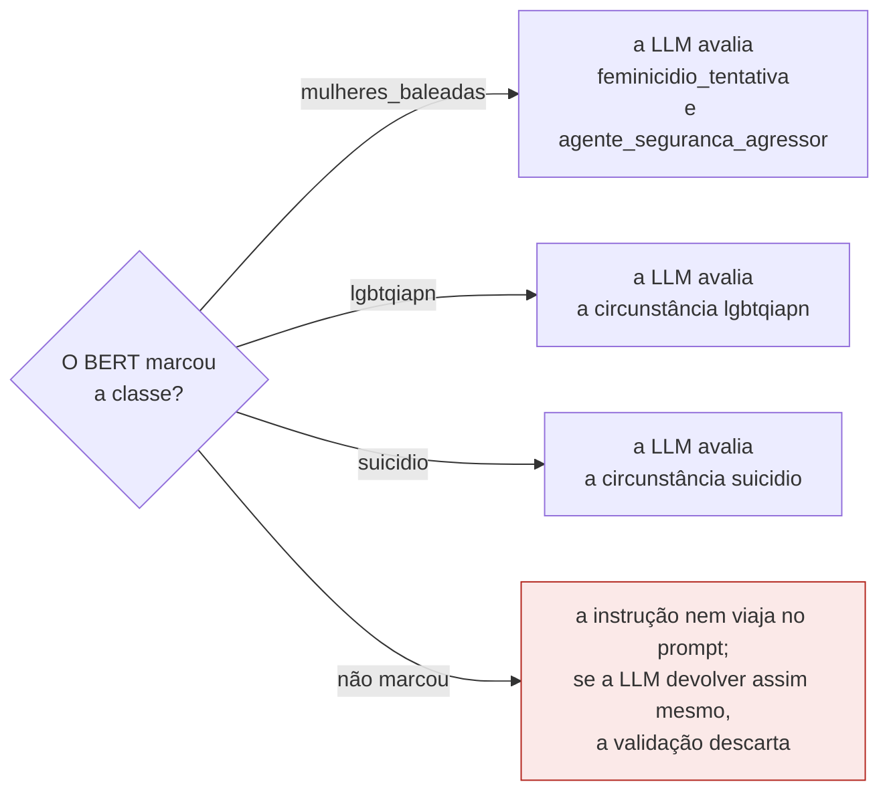
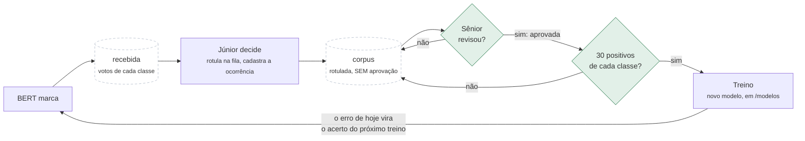

# Fluxograma do classificador

Fonte em Mermaid dos diagramas do fluxo. Renderiza direto no GitHub e na
pré-visualização de Markdown do VS Code; para exportar imagem, use
<https://mermaid.live>.

Mantenha este arquivo junto do código: um fluxograma que descreve uma versão
antiga do fluxo é pior que nenhum.

---

## 1. O caminho de uma notícia

A notícia chega **antes** de existir ocorrência. Quem olha primeiro é o
classificador, e é a marcação dele que decide se vale abrir registro — por isso
a abertura da ocorrência aparece no meio do caminho, não no começo.

**Por que o arquivo existe.** O escopo do sistema é o catálogo de indicadores,
não todo tiroteio. Homem adulto baleado num assalto não sustenta nenhuma das
oito classes: mandá-lo à LLM gastaria a chamada para receber "nada se aplica" de
volta. Ele vai para o acervo, não conta como pendência, e volta a ser lido
quando houver modelo novo ou indicador novo.

**Por que a limpeza vem ANTES do BERT, e é a mesma para os dois.** O BERT e a
LLM leem o mesmo texto limpo, e isso é o que os faz concordar por construção.
Antes o BERT lia o texto cru e a LLM lia o podado: a triagem prometia "duas
classes marcadas" a partir de um texto e o portão do prompt era decidido de
novo a partir de outro, divergência que não aparecia em tela nenhuma.

**O critério da poda é invertido de propósito.** Uma linha só sai quando casa
com um padrão de ruído de portal E não carrega nenhum marcador de fato — nem
palavra do domínio, nem idade, nem contagem de pessoas, nem horário. A versão
anterior fazia o contrário, mantinha o que parecia relevante, e por isso
apagava fato: saíram "Mulher estava atrás de viatura" e "os dois estavam
conscientes e sem gravidade aparente". Deixar lixo passar custa ~40 tokens;
deixar fato sair custa uma classificação errada. Com o critério invertido, o
erro cai sempre para o lado barato — e por isso a poda pôde ser LIGADA, depois
de meses desligada.

**A limpeza também desofusca.** `m0rto a tir0s`, que é como as redes sociais
escrevem para furar moderação automática, volta a ser `morto a tiros`. A troca
de dígito por letra só acontece quando a palavra mistura letra e dígito E o
resultado é um termo do domínio: `45 anos` e `41º BPM` não têm letra junto do
dígito e nunca são tocados, porque idade adulterada seria pior que a ofuscação.

Medido nas cinco notícias do banco: **-19,8% de caracteres, 381 tokens**, com
os doze fatos materiais da lista de regressão intactos.

## 2. Quem decide cada fenômeno

Duas perguntas separadas: **onde o resultado vai** (fenômeno da ocorrência ou
circunstância da vítima) e **quem decide**.

**Chacina é derivada, não pedida — o fenômeno E a circunstância.** A conta é:
**conta quem morreu, menos o agente de segurança que estava em serviço.** Três
civis mortos é chacina. Dois civis mais um agente morto é chacina dos três se
o agente estava de folga, aposentado ou sem status informado; se ele estava em
serviço, fica fora da contagem e sobram dois — e aí não há chacina.

O agente em serviço sai porque numa ação policial ele está do outro lado do
mesmo fato: se ele é baleado e mata três pessoas, a chacina é das três. De
folga, ele é uma pessoa como as outras e conta.

A circunstância de cada vítima sai da MESMA conta que o fenômeno, e é isso que
impede um fenômeno que nenhuma vítima sustenta, ou uma chacina marcada em duas.
A LLM não a marca: só preenche o `status` da vítima e o `status_agente` do
agente, que é de onde a conta sai. A marcação também SAI sozinha — quando um
morto se revela ferido, ou o status de serviço é corrigido, ela desaparece de
todas as vítimas. Marcação derivada que só sabe entrar vira sujeira permanente.

**Vitimização policial é das duas coisas.** Tem classe de BERT *e* regra sobre a
lista de vítimas. A regra sozinha não bastava: ela roda **depois** da LLM, e o
portão que decide se a LLM é chamada acontece **antes**. Policial baleado de
folga — que não é ação policial — não disparava classe nenhuma e ia para o
arquivo em silêncio. Vale como regra geral: **indicador que só existe como regra
não pode controlar o portão da LLM.**

## 3. A marcação autoriza

Quatro circunstâncias dependem de uma classe marcada. Outras quatro —
`bala_perdida`, `trajeto_escolar`, `acidente`, `tribunal_do_crime` — estão
sempre disponíveis: reconhecê-las na leitura não depende de uma classe própria.
E `chacina` não é oferecida à LLM em caso nenhum: o sistema a calcula.

Sem modelo treinado — que é o estado de hoje — `marcados` chega como `None` e
todas ficam liberadas: não há marcação para condicionar nada.

## 4. O ciclo que faz o modelo melhorar

São duas portas de entrada para o corpus, e as duas são necessárias:

- **Rotular na fila** — a pessoa marca os indicadores direto na notícia
  recebida. Vai ao corpus mesmo com a lista vazia: "li e não há fenômeno" é o
  exemplo negativo que ensina o modelo a não marcar nada. Entra **sem
  aprovação**.
- **Aprovar a ocorrência** — cada notícia vinculada vai ao corpus com os
  fenômenos que sobreviveram à conferência, e **já aprovada**. É o rótulo de
  melhor qualidade que existe no sistema, porque passou por duas leituras.

### Estar no corpus não é estar no treino

Duas perguntas, duas colunas: `rotulada` (alguém leu e decidiu) e `aprovada`
(alguém revisou e assumiu). **Só o aprovado treina.**

O motivo é a divisão de trabalho real: quem cadastra a ocorrência é o analista
júnior, quem revisa é o sênior. Um rótulo errado do júnior não produz um erro
visível — produz um modelo pior, que erra em notícia que ninguém está olhando.
É defeito que não aparece em tela nenhuma, e por isso a trava é na consulta de
treino (`corpus.TREINAVEL`) e não na confiança.

Mudar o rótulo derruba a aprovação: rótulo novo é afirmação nova, e quem
assinou a anterior não assinou esta. O que não está aprovado fica visível e
editável em `/corpus`, esperando revisão — é exatamente a fila de trabalho do
sênior, e não lixo.

Aprovar a ocorrência tem a caixa **servir de exemplo de treino** marcada por
padrão. Desmarcá-la grava a notícia no corpus sem aprovação, em vez de não
gravar: serve ao registro que está certo mas é exemplo ruim — texto truncado,
duas ocorrências misturadas, fonte duvidosa.

**A trava dos 30.** O treino só roda quando CADA classe do catálogo tem 30
positivos aprovados, na tela e na linha de comando. Antes era só um aviso, e o
que ele deixava passar era pior que o incômodo: uma classe com 2 exemplos — ou
com zero, num indicador recém-criado — treinava para dizer sempre não e saía
com F1 0, que parece defeito do modelo e é falta de dado. Quando uma classe
rara segura o resto, `rodar_treino.py --classe` treina só o subconjunto pronto,
com a mesma trava aplicada a ele.

### Indicador novo abre dois buracos, e os dois agora avisam

O catálogo é dado: `/gestao` cadastra um indicador e tudo se ajusta. O que não
se ajusta sozinho:

| buraco | o que o sistema faz |
|---|---|
| O modelo treinado **ignora** a classe nova — a inferência lê os rótulos do manifesto dele, não do catálogo | `inferencia.defasagem()` compara os dois; `/modelos` e `/recebidas` mostram aviso vermelho nomeando o que falta |
| O corpus existente vira exemplo **negativo** dela, porque aquelas notícias nunca foram lidas com a pergunta | o indicador guarda `criado_em`; `/corpus` conta as anteriores e oferece o filtro *Reler por causa de* |

O segundo é o mais caro: se trinta notícias antigas de fato sustentam o
indicador novo, o corpus está ensinando que não sustentam, e o sintoma é um
indicador que o modelo nunca marca.

Depois de treinar, **Reavaliar o arquivo** em `/recebidas` relê o acervo com o
modelo novo. É o passo que recupera a notícia arquivada antes de o indicador
existir.

Sem esse registro o erro do BERT desaparece assim que a LLM o corrige: o
registro final fica certo e ninguém fica sabendo que o classificador errou.
